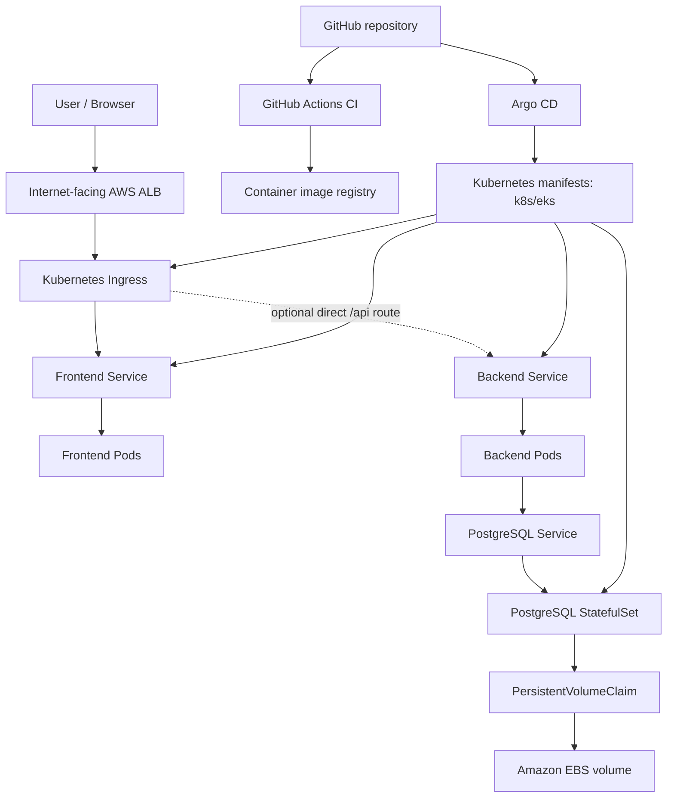

# DevBoard

<p align="center">
  <strong>A cloud-native application on Amazon EKS, delivered with GitOps.</strong>
</p>

<p align="center">
  <code>Amazon EKS</code> · <code>Kubernetes</code> · <code>Argo CD</code> · <code>AWS ALB</code> · <code>GitHub Actions</code> · <code>PostgreSQL</code>
</p>

DevBoard deploys a frontend, backend, and PostgreSQL database to Amazon EKS. GitHub Actions builds the application images, while Argo CD continuously reconciles the Kubernetes manifests in `k8s/eks/`. The AWS Load Balancer Controller provisions an internet-facing Application Load Balancer (ALB) from the Kubernetes Ingress.

> **Note:** Review AWS costs before deploying. EKS, EC2 worker nodes, load balancers, EBS volumes, and related resources may incur charges.

## Contents

- [Architecture](#architecture)
- [Technology stack](#technology-stack)
- [Prerequisites](#prerequisites)
- [1. Create the EKS cluster](#1-create-the-eks-cluster)
- [2. Configure persistent storage](#2-configure-persistent-storage)
- [3. Install AWS Load Balancer Controller](#3-install-aws-load-balancer-controller)
- [4. Install Argo CD](#4-install-argo-cd)
- [5. Connect Argo CD to the repository](#5-connect-argo-cd-to-the-repository)
- [6. Verify the deployment](#6-verify-the-deployment)
- [Troubleshooting](#troubleshooting)
- [Cleanup](#cleanup)

## Architecture



**Request flow:** The ALB sends requests to the Kubernetes routing configuration. The README's verification commands assume `/` serves the frontend and the frontend proxies `/api/health` to the backend.

**GitOps flow:** GitHub Actions builds and publishes images; Argo CD deploys the Kubernetes manifests from `k8s/eks/`. Keep application configuration and Kubernetes manifests in Git, and avoid making manual cluster changes that conflict with Argo CD reconciliation.

## Technology stack

| Component | Purpose |
|---|---|
| Amazon EKS | Managed Kubernetes control plane |
| Managed EC2 node group | Runs application and database workloads |
| Docker | Packages frontend and backend images |
| GitHub Actions | CI pipeline |
| Container registry | Stores built application images |
| Argo CD | GitOps deployment and drift reconciliation |
| AWS Load Balancer Controller | Creates AWS load balancers from Kubernetes resources |
| Application Load Balancer | External HTTP entry point |
| EBS CSI driver | Dynamically provisions EBS-backed persistent volumes |
| PostgreSQL | Application database |

## Prerequisites

Install and configure:

- AWS CLI, with credentials that can access the target AWS account.
- `eksctl`, `kubectl`, and Helm.
- An AWS account with permissions to create EKS, IAM, EC2/VPC, ELB, and EBS resources.
- A GitHub repository containing the application and the Kubernetes manifests under `k8s/eks/`.

Confirm that your AWS credentials work:

```bash
aws sts get-caller-identity
aws configure get region
```

Set the environment variables used by the commands below:

```bash
export CLUSTER=devboard-eks
export REGION=ap-south-1
export ACCOUNT_ID=$(aws sts get-caller-identity --query Account --output text)
```

## 1. Create the EKS cluster

The following command creates a managed node group with two `t3.medium` worker nodes and a scaling range of two to three nodes.

```bash
eksctl create cluster \
  --name devboard-eks \
  --region ap-south-1 \
  --version 1.36 \
  --nodegroup-name devboard-workers \
  --node-type t3.medium \
  --nodes 2 \
  --nodes-min 2 \
  --nodes-max 3 \
  --managed
```

Check cluster access and node readiness:

```bash
aws eks update-kubeconfig --name "$CLUSTER" --region "$REGION"
kubectl get nodes -o wide
kubectl get namespaces
```

Confirm that the requested Kubernetes version is supported in your AWS region before running the create command.

## 2. Configure persistent storage

The PostgreSQL StatefulSet uses a PVC and the `ebs-gp3` StorageClass. The EBS CSI driver must be installed and authorized to create and attach volumes.

Associate the cluster's IAM OIDC provider:

```bash
eksctl utils associate-iam-oidc-provider \
  --cluster "$CLUSTER" \
  --region "$REGION" \
  --approve
```

Create the IAM role for the EBS CSI driver service account:

```bash
eksctl create iamserviceaccount \
  --cluster "$CLUSTER" \
  --region "$REGION" \
  --name ebs-csi-controller-sa \
  --namespace kube-system \
  --attach-policy-arn arn:aws:iam::aws:policy/service-role/AmazonEBSCSIDriverPolicy \
  --approve \
  --role-only \
  --role-name AmazonEKS_EBS_CSI_DriverRole
```

Install the EBS CSI managed add-on:

```bash
aws eks create-addon \
  --cluster-name "$CLUSTER" \
  --region "$REGION" \
  --addon-name aws-ebs-csi-driver \
  --service-account-role-arn "arn:aws:iam::${ACCOUNT_ID}:role/AmazonEKS_EBS_CSI_DriverRole"
```

If the add-on already exists, inspect it first rather than attempting to create it again:

```bash
aws eks describe-addon \
  --cluster-name "$CLUSTER" \
  --region "$REGION" \
  --addon-name aws-ebs-csi-driver
```

Verify the driver and StorageClass:

```bash
kubectl get pods -n kube-system | grep ebs-csi
kubectl get storageclass
```

> **Important:** An EBS volume is Availability Zone-specific. Make sure the StorageClass uses `volumeBindingMode: WaitForFirstConsumer` so Kubernetes can provision the volume in an appropriate Availability Zone for the scheduled pod.

## 3. Install AWS Load Balancer Controller

The controller watches Kubernetes Ingress resources and provisions ALBs. It needs an IAM policy and a Kubernetes service account associated with an IAM role.

### 3.1 Associate OIDC

If you already ran this in Step 2, you do not need to repeat it:

```bash
eksctl utils associate-iam-oidc-provider \
  --cluster "$CLUSTER" \
  --region "$REGION" \
  --approve
```

### 3.2 Create the controller IAM policy

Download the policy document from the AWS Load Balancer Controller project:

```bash
curl -Lo iam_policy.json \
  https://raw.githubusercontent.com/kubernetes-sigs/aws-load-balancer-controller/main/docs/install/iam_policy.json
```

Create the IAM policy. If it already exists, reuse its ARN instead of creating a duplicate:

```bash
aws iam create-policy \
  --policy-name AWSLoadBalancerControllerIAMPolicy \
  --policy-document file://iam_policy.json
```

Set the policy ARN:

```bash
export LBC_POLICY_ARN="arn:aws:iam::${ACCOUNT_ID}:policy/AWSLoadBalancerControllerIAMPolicy"
```

### 3.3 Create the service account and IAM role

```bash
eksctl create iamserviceaccount \
  --cluster "$CLUSTER" \
  --region "$REGION" \
  --namespace kube-system \
  --name aws-load-balancer-controller \
  --attach-policy-arn "$LBC_POLICY_ARN" \
  --approve
```

If the service account already exists or is managed elsewhere, inspect its annotations and IAM role before changing it.

### 3.4 Install the controller with Helm

```bash
helm repo add eks https://aws.github.io/eks-charts
helm repo update

helm upgrade --install aws-load-balancer-controller \
  eks/aws-load-balancer-controller \
  --namespace kube-system \
  --set clusterName="$CLUSTER" \
  --set serviceAccount.create=false \
  --set serviceAccount.name=aws-load-balancer-controller
```

Verify that the controller is available:

```bash
kubectl rollout status deployment/aws-load-balancer-controller -n kube-system
kubectl get deployment aws-load-balancer-controller -n kube-system
```

For an internet-facing ALB, the VPC must have suitable public subnets and the required subnet tags for AWS Load Balancer Controller subnet discovery. Confirm these tags and your security-group rules before troubleshooting Ingress provisioning.

## 4. Install Argo CD

Create the namespace and install Argo CD. Server-side apply avoids the oversized last-applied annotation problem that can occur with large CRDs.

```bash
kubectl create namespace argocd --dry-run=client -o yaml | kubectl apply -f -

kubectl apply \
  --server-side \
  --force-conflicts \
  -n argocd \
  -f https://raw.githubusercontent.com/argoproj/argo-cd/stable/manifests/install.yaml

kubectl rollout status deployment/argocd-server -n argocd
```

For a temporary local UI session, port-forward the service:

```bash
kubectl port-forward svc/argocd-server -n argocd 8080:443
```

Open [https://localhost:8080](https://localhost:8080). The initial username is `admin`. Retrieve the initial password with:

```bash
kubectl get secret argocd-initial-admin-secret \
  -n argocd \
  -o jsonpath='{.data.password}' | base64 -d
echo
```

Change the initial password and remove the initial admin secret according to your operational policy after setup. Do not publish the password in logs, screenshots, or Git.

## 5. Connect Argo CD to the repository

Create an Argo CD `Application` that points at the `k8s/eks/` directory. Replace the repository URL if you use your own fork.

```bash
kubectl apply -f - <<'EOF'
apiVersion: argoproj.io/v1alpha1
kind: Application
metadata:
  name: devboard-eks
  namespace: argocd
spec:
  project: default
  source:
    repoURL: https://github.com/LondheShubham153/devboard-starter.git
    targetRevision: main
    path: k8s/eks
  destination:
    server: https://kubernetes.default.svc
    namespace: devboard-ns
  syncPolicy:
    automated:
      prune: true
      selfHeal: true
    syncOptions:
      - CreateNamespace=true
EOF
```

Argo CD will sync the manifests in `k8s/eks/` and reconcile drift. With automated pruning enabled, removing a resource from Git can remove it from the cluster. Review changes before merging them into the tracked branch.

**Before relying on GitOps:** Verify that the manifests include the frontend and backend Services, Ingress, PostgreSQL StatefulSet/PVC, and any required configuration. Store secrets in an appropriate secret-management solution rather than committing plaintext credentials to Git.

## 6. Verify the deployment

### 6.1 Check Argo CD and workloads

```bash
kubectl -n argocd get application devboard-eks
kubectl get nodes
kubectl get pods,services -n devboard-ns
kubectl get pvc -n devboard-ns
kubectl get ingress -n devboard-ns
```

Check that pods are ready, the PostgreSQL PVC is `Bound`, and the Argo CD application is `Synced` and `Healthy`.

### 6.2 Get the ALB DNS name

```bash
export ALB_DNS=$(kubectl get ingress -n devboard-ns \
  -o jsonpath='{.items[0].status.loadBalancer.ingress[0].hostname}')

echo "$ALB_DNS"
```

The address may take a few minutes to appear after the Ingress is created.

### 6.3 Test the application

The following tests assume that the frontend is served at `/` and proxies `/api/health` to the backend:

```bash
curl -I "http://${ALB_DNS}/"
curl -i "http://${ALB_DNS}/api/health"
```

If the backend should be routed directly by the ALB instead, configure an Ingress rule for `/api` targeting the backend Service and test the actual backend health endpoint. Ensure the frontend's API base URL and backend path handling agree with that routing strategy.

## Troubleshooting

| Symptom | What to check |
|---|---|
| Ingress has no ALB address | Controller logs, Ingress events, subnet tags, IAM permissions, and AWS quotas |
| ALB targets are unhealthy | Service selectors, target port, pod readiness, security groups, and health-check path |
| Frontend returns `404` | Frontend routes, Ingress path rules, and SPA fallback configuration |
| `/api/health` fails | Frontend proxy configuration or direct `/api` Ingress routing, backend endpoints, and application health path |
| Pods are `Pending` | Node capacity, scheduling events, PVC status, and Availability Zone constraints |
| PostgreSQL PVC is not `Bound` | EBS CSI controller, StorageClass, IAM role, and PVC events |
| Argo CD keeps reverting a change | Update the Git manifest or commit the desired configuration instead of editing the live resource |

Useful diagnostic commands:

```bash
kubectl logs -n kube-system deployment/aws-load-balancer-controller
kubectl describe ingress -n devboard-ns
kubectl get endpoints -n devboard-ns
kubectl get events -n devboard-ns --sort-by=.lastTimestamp
kubectl describe pods -n devboard-ns
kubectl describe pvc -n devboard-ns
kubectl -n argocd get application devboard-eks -o yaml
```

## Cleanup

> **Destructive:** This removes application resources and the EKS cluster. Back up any data you need first. Deleting a namespace can delete the PVC and its EBS volume, depending on the StorageClass reclaim policy.

Delete the Argo CD Application first so automated sync does not recreate resources:

```bash
kubectl delete application devboard-eks -n argocd
```

Delete the application namespace and allow the Ingress controller to remove the ALB:

```bash
kubectl delete namespace devboard-ns
```

Check for remaining load balancers:

```bash
aws elbv2 describe-load-balancers \
  --region "$REGION" \
  --query 'LoadBalancers[].LoadBalancerName' \
  --output table
```

Remove Argo CD and the controller, then delete the cluster:

```bash
kubectl delete namespace argocd
helm uninstall aws-load-balancer-controller -n kube-system

eksctl delete cluster \
  --name "$CLUSTER" \
  --region "$REGION"
```

If you created the controller IAM policy specifically for this cluster and it is no longer used, delete it after confirming no other cluster depends on it:

```bash
aws iam delete-policy \
  --policy-arn "arn:aws:iam::${ACCOUNT_ID}:policy/AWSLoadBalancerControllerIAMPolicy"
```

Finally, check the AWS Console for remaining EBS volumes, load balancers, target groups, security groups, and network interfaces. These may continue to incur charges if they remain after cluster deletion.

---

## Production-readiness checklist

- [ ] Use HTTPS with an ACM certificate and redirect HTTP to HTTPS.
- [ ] Keep PostgreSQL private; do not expose its Service through the public Ingress.
- [ ] Use Kubernetes Secrets backed by a secure secret-management workflow; do not commit credentials.
- [ ] Configure resource requests/limits, readiness/liveness probes, and PodDisruptionBudgets where appropriate.
- [ ] Verify that worker nodes have enough CPU and memory for the frontend, backend, and database.
- [ ] Consider multi-AZ node placement and database backup/restore procedures.
- [ ] Pin and review controller/chart versions rather than relying indefinitely on unpinned latest versions.
- [ ] Review AWS cost and clean up unused resources after testing.
